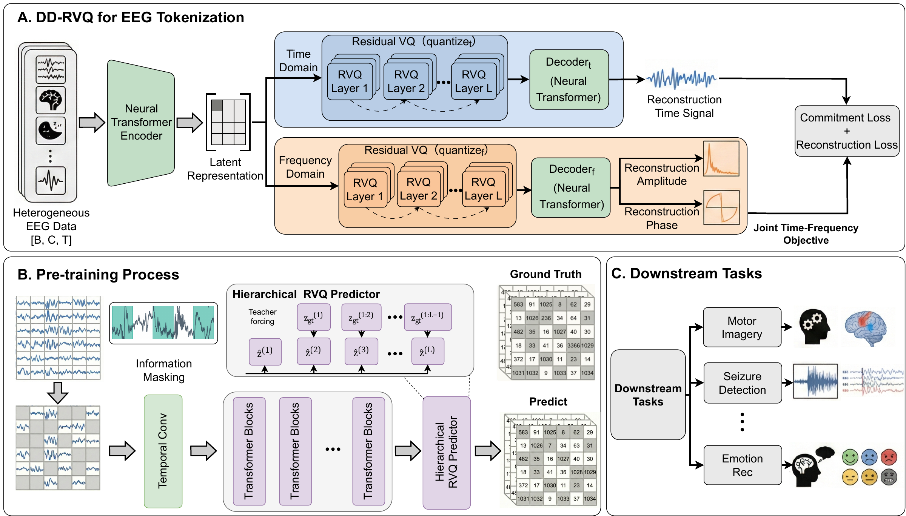
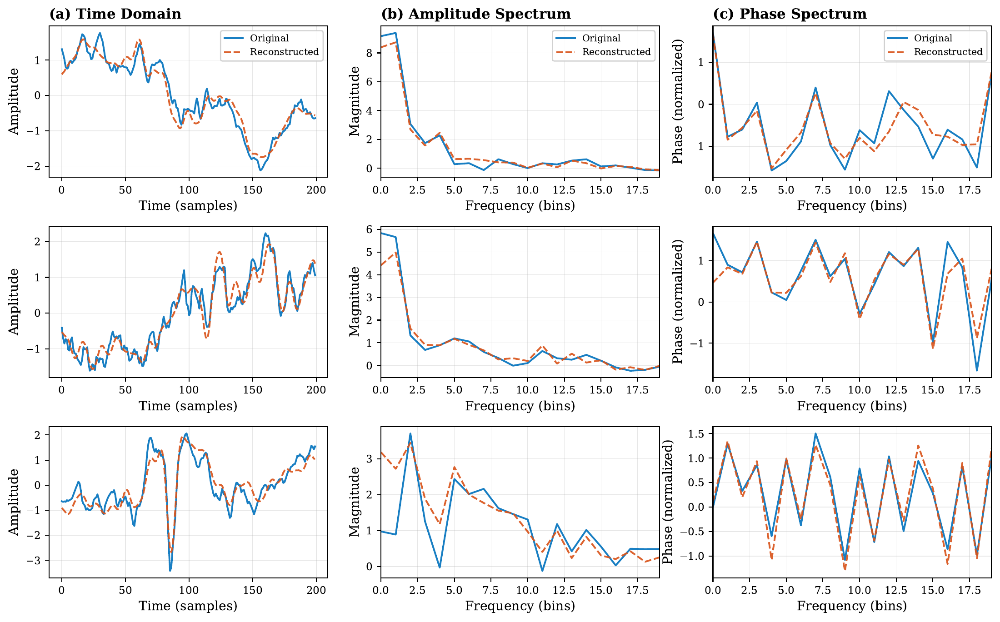
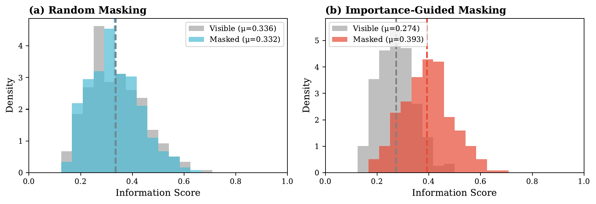

<h1 align="center">BrainRVQ</h1>

<h3 align="center">EEG Representation Learning via Dual-Domain Residual Quantization and Hierarchical Autoregression</h3>

<p align="center">
  <a href="https://arxiv.org/abs/2602.16951">Paper (arXiv)</a> &nbsp;|&nbsp;
  <a href="https://arxiv.org/pdf/2602.16951">PDF</a> &nbsp;|&nbsp;
  <a href="#method">Method</a> &nbsp;|&nbsp;
  <a href="#reported-downstream-results">Results</a> &nbsp;|&nbsp;
  <a href="#visualizations">Visualizations</a> &nbsp;|&nbsp;
  <a href="#using-the-source">Getting started</a> &nbsp;|&nbsp;
  <a href="#pre-trained-weights">Weights</a>
</p>

BrainRVQ learns transferable EEG representations from hierarchical discrete targets. It combines a **Dual-Domain Residual Vector Quantization (DD-RVQ)** tokenizer, **hierarchical autoregressive pre-training**, and **importance-guided curriculum masking**.

The framework is pre-trained on over **9,200 hours of clinical EEG** from the Temple University Hospital EEG Corpus (TUEG) and evaluated on eight downstream datasets covering seizure detection, abnormality detection, event classification, motor imagery, emotion recognition, and mental workload classification.

<p align="center">
  <a href="assets/framework.png"></a>
</p>

**Framework overview.** DD-RVQ constructs temporal and frequency code hierarchies. The encoder learns from masked code prediction conditioned on preceding residual levels, then transfers to downstream EEG tasks through fine-tuning.

| Pre-training data | Downstream evaluation | Token hierarchy |
| :---: | :---: | :---: |
| **9,200+ hours** of clinical EEG | **8 datasets** across clinical and BCI tasks | **3 residual levels** in each of **2 domains** |

## Method

### 1. Dual-domain EEG tokenization

A shared encoder maps EEG patches into latent representations. Separate temporal and frequency RVQ branches encode these representations into coarse-to-fine code sequences. Domain-specific decoders reconstruct the waveform and the amplitude and phase spectra.

Each branch uses three residual quantization levels, with 8,192 code vectors of dimension 64 per level.

### 2. Hierarchical autoregressive pre-training

The encoder learns to predict masked EEG codes. At each patch position, finer-level predictions are conditioned on the preceding coarser-level codes using teacher forcing. Prediction follows the residual hierarchy within each patch.

### 3. Importance-guided curriculum masking

Mask sampling combines random scores with spectral and temporal signal scores. The influence of signal-based scores increases during training. The encoder is trained on two complementary masking views.

### 4. Downstream adaptation

The pre-trained encoder and a task-specific classification head are fine-tuned end-to-end. Downstream classification uses encoder features; it does not require the tokenizer or autoregressive code prediction.

## Reported downstream results

Selected metrics from the manuscript are shown below. Values are mean ± standard deviation over five downstream fine-tuning runs using a shared pre-trained encoder checkpoint and fixed dataset partitions.

| Dataset | Metric | BrainRVQ |
| --- | --- | --- |
| Mental Workload | AUROC | 0.862 ± 0.010 |
| CHB-MIT | AUROC | 0.928 ± 0.024 |
| CHB-MIT | AUC-PR | 0.465 ± 0.036 |
| SHU-MI | AUROC | 0.717 ± 0.007 |
| TUAB | AUROC | 0.900 ± 0.002 |
| BCICIV-2a | Cohen's Kappa | 0.388 ± 0.008 |
| PhysioNet-MI | Cohen's Kappa | 0.523 ± 0.015 |
| TUEV | Cohen's Kappa | 0.690 ± 0.008 |
| SEED-V | Cohen's Kappa | 0.260 ± 0.010 |

## Visualizations

### Waveform and spectral reconstruction

<p align="center">
  <a href="assets/reconstruction.png"></a>
</p>

**Selected high-fidelity reconstruction examples.** Rows show three EEG segments; columns show waveforms, amplitude spectra, and phase spectra. Blue curves are the original signals and orange dashed curves are the reconstructions. Spectral panels show the first 20 frequency bins.

Aggregate results over 7,928 segments from the tokenizer training data are summarized below.

| Metric | Waveform | Amplitude | Phase |
| --- | --- | --- | --- |
| Correlation | 0.904 ± 0.030 | 0.956 ± 0.016 | 0.577 ± 0.042 |
| SNR (dB) | 8.1 ± 1.2 | 11.2 ± 1.2 | 2.0 ± 0.5 |

### Importance-guided masking

<p align="center">
  <a href="assets/masking.png"></a>
</p>

**Patch-score distributions in an example EEG recording.** Random masking produces similar score distributions for visible and masked patches. Importance-guided sampling shifts the masked subset toward higher scores. Gray denotes visible patches; colored distributions denote masked patches; dashed lines indicate their means.

## Pre-trained weights

The DD-RVQ tokenizer and pre-trained encoder checkpoints will be released upon acceptance of the paper. Download links will be added here.

## Repository structure

```text
BrainRVQ/
├── assets/                          # Figures displayed in this README
├── DDRVQ/
│   ├── ddrvq_main.py                 # Tokenizer training entry point
│   ├── modeling_ddrvq.py             # Dual-domain tokenizer and reconstruction
│   ├── rvq.py                        # Residual vector quantization and EMA updates
│   ├── engine_for_ddrvq.py            # Tokenizer training and evaluation
│   └── optim_factory.py              # Optimizer construction
├── Pretraining/
│   ├── pretraining_main.py           # Encoder pre-training entry point
│   ├── modeling_pretrain.py          # Hierarchical conditional prediction
│   └── engine_for_pretraining.py     # Mask sampling and pre-training loop
├── Downstream/
│   ├── finetuning_main.py            # Downstream training and evaluation
│   ├── modeling_finetune.py          # EEG encoder and classification model
│   └── engine_for_finetuning.py      # Fine-tuning and evaluation loop
└── utils.py                          # Dataset loaders and shared utilities
```

## Model configuration

| Setting | Configuration |
| --- | --- |
| Sampling rate | 200 Hz |
| Patch duration | 1 second, or 200 samples |
| Pre-training input | 19 channels × 30 seconds |
| Transformer encoder | 12 layers, hidden dimension 200, 10 attention heads |
| Tokenizer decoder | 3 Transformer layers |
| RVQ depth | 3 levels per domain |
| Codebook size | 8,192 entries per level |
| Code-vector dimension | 64 |
| Tokenizer training | 20 epochs |
| Encoder pre-training | 20 epochs |

The experiments used Python 3.10, PyTorch 2.1.2, and CUDA 11.8. Python dependencies referenced by the source include `timm`, `einops`, `numpy`, `scipy`, `h5py`, `pandas`, `scikit-learn`, `tensorboardX`, and `pyhealth`.

## Data preparation

Obtain the datasets from their respective providers and prepare them according to the dataset-specific protocols in the manuscript and supplementary material.

- **Pre-training:** TUEG recordings are resampled to 200 Hz and segmented into 30-second samples with 19 channels. Recordings belonging to the TUAB and TUEV test sets are excluded from pre-training.
- **Pre-training storage:** `utils.H5AggregatedDataset` reads HDF5 files containing `eeg_data` and `ch_names`. The training entry points search for `TUEG_*.hdf5` files.
- **Downstream data:** Dataset loaders and partitioning functions are defined in `utils.py`. Dataset selection is handled by `get_dataset()` in `Downstream/finetuning_main.py`.
- **Input layout:** The downstream training loop receives EEG samples in `[batch, channels, time]` format and reshapes them into 200-sample patches.

| Dataset | Selector in the downstream script | Task |
| --- | --- | --- |
| TUAB | `TUAB` | Abnormality detection |
| TUEV | `TUEV` | Six-class event classification |
| CHB-MIT | `CHBMIT` | Seizure detection |
| SEED-V | `SEEDV` | Five-class emotion recognition |
| PhysioNet-MI | `Physio` | Four-class motor imagery |
| SHU-MI | `SHU` | Binary motor imagery |
| BCICIV-2a | `BCICIV2a` | Four-class motor imagery |
| Mental Workload | `Mental` | Binary mental workload classification |

## Using the source

Clone the repository:

```bash
git clone https://github.com/keqicmz/BrainRVQ.git
cd BrainRVQ
```

The workflow is **tokenizer training → encoder pre-training → downstream fine-tuning**. The corresponding entry points are listed above.

Before launching the current scripts:

1. Replace the placeholder data paths in the training entry points with your local dataset locations.
2. Make the repository root and the `DDRVQ`, `Pretraining`, and `Downstream` directories available on the Python import path.
3. Align the legacy model defaults with the registered names below. The pre-training entry point also retains an `import modeling_vqnsp` statement; the tokenizer implementation provided here is `DDRVQ/modeling_ddrvq.py`.
4. Resolve the local `data_processor.dataset.ShockDataset` dependency imported by `utils.py`; that module is not included in the current repository.

| Stage | Registered model name | Checkpoint argument |
| --- | --- | --- |
| Tokenizer | `ddrvq_encoder_base_decoder_3x200x12` | `--resume` for resuming training |
| Encoder pre-training | `brainrvq_base_patch200_1600_8k_vocab` | `--tokenizer_weight` and `--tokenizer_model` |
| Downstream fine-tuning | `brainrvq_base_patch200_200` | `--finetune` |

The current repository provides the model and training source. End-to-end launch commands depend on the data paths and import configuration described above; a packaged reproduction environment is not yet provided.

## Acknowledgments

The implementation builds on LaBraM. We thank the authors and the EEG dataset providers for making their research resources available.

## Contact

For questions about the implementation, please [open an issue](https://github.com/keqicmz/BrainRVQ/issues).
